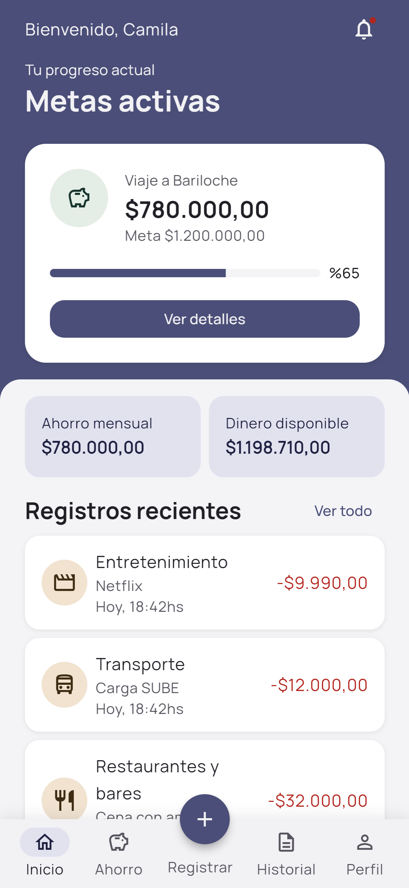
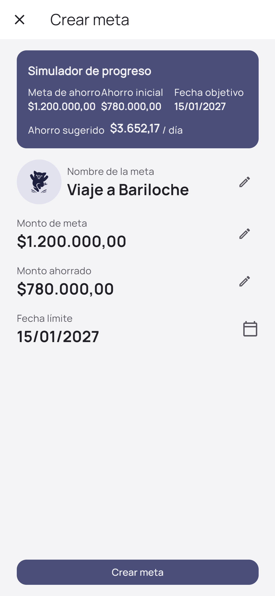
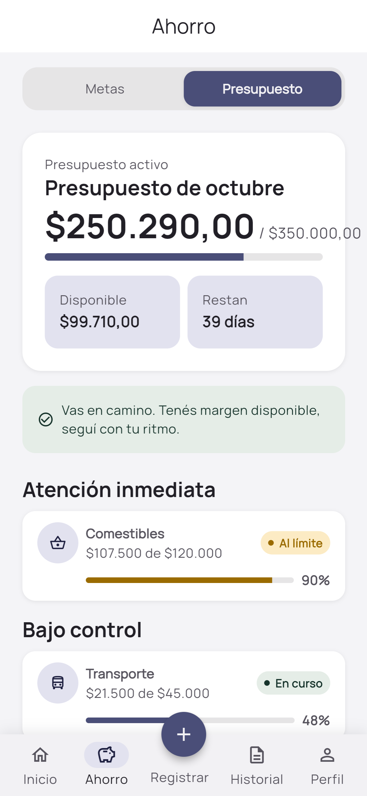
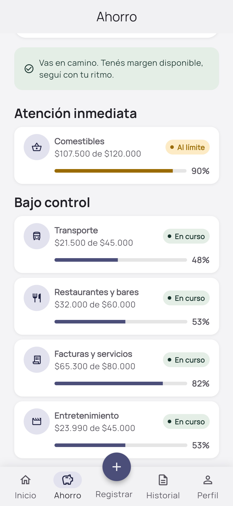
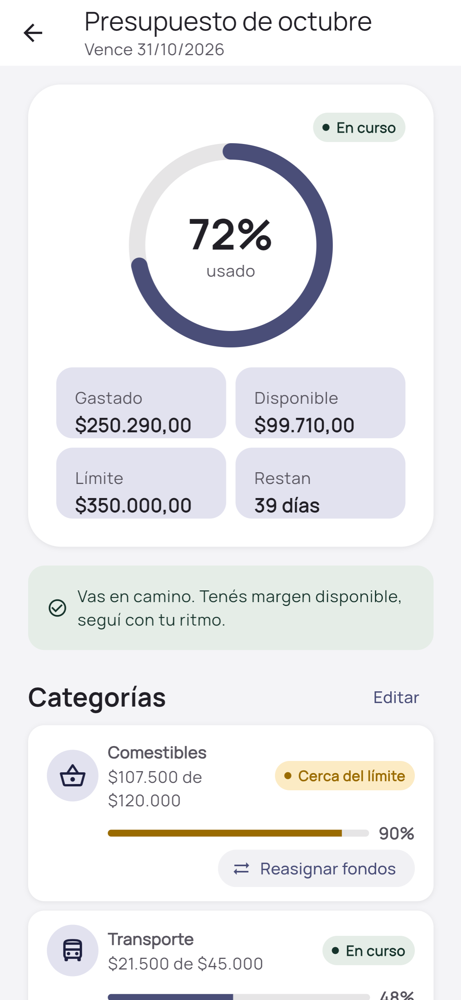

# Milestone (Hito)

**A personal finance app for people who stopped tracking their money and want to come back, without guilt.**

Designed, built and tested end to end by [Sofía Álvarez](https://www.linkedin.com/in/sof%C3%ADa-%C3%A1lvarez-20/), Product Designer & Design Engineer.

**Live app:** [milestone-cc9af.web.app](https://milestone-cc9af.web.app/) · **Case study:** [portfolio](https://sofia-alvarez-ux-iu.vercel.app/) · **Testing prototype:** [Figma](https://www.figma.com/proto/tyqQYxiMCd4pXPxLjvSynJ/Milestone---Testing-Maze?page-id=0%3A1&node-id=26-74)

<p>
  
  
  
  
  
</p>

## Results

| | |
|---|---|
| **6.55 / 7** | SEQ (perceived ease) on Goals, the most complex flow, across 5 moderated sessions |
| **88.9%** | completed the daily expense log with no help (unmoderated test in Maze) |
| **17 / 20** | task sessions completed directly or with minimal help |
| **9** | fixes shipped to production, each verified with `flutter analyze` and `flutter build web` |
| **1 critical bug** | caught in testing before release: a goal was marked as achieved after a small partial contribution, a data integrity issue that would have broken user trust |

## The problem

Research interviews showed that the issue was not tools or information, it was emotional. People start tracking their spending when they feel lost, keep the habit while they regain control, and drop it as soon as they feel calm. When they come back, most apps greet them with red numbers.

Milestone is designed for that moment of return. The Home screen does not open with a deficit: it invites the person to adjust their goal to their real situation, keeping their progress.

## From design to code

The whole product was built by one person, directing AI-assisted development. Every design and product decision was mine; the AI implemented.

```
Research ─► Architecture ─► Lo-fi ─► Hi-fi ─► Spec ─► Build ─► Self QA ─► Testing ─► Fix & deploy
```

1. **Research and definition.** Discovery interviews, journey map, How Might We. Scope decision: a tracking app, not a wallet, with emotional closure as the differentiator.
2. **Information architecture.** Card sorting and sitemap. A "Financial education" section passed card sorting but contradicted the research ("keep it simple"), so it was removed and turned into contextual tips. That freed the navigation for Savings (Goals and Budgets). Full sitemap: [`docs/sitemap.md`](docs/sitemap.md).
3. **Visual system.** A deliberately non-banking palette (soft indigo, sand, sage) on Material Design 3 roles, light and dark, with contrast checked against WCAG AA. Documented in [`docs/sistema-visual-hito.md`](docs/sistema-visual-hito.md) and implemented as tokens in [`lib/theme/app_theme.dart`](lib/theme/app_theme.dart).
4. **Spec-driven build.** Before the first development prompt, each Figma screen and flow was translated into an unambiguous specification. The app was then built with Claude Code in Flutter (closest to Material Design 3) and Firebase.
5. **Code to design.** The high-fidelity screens for the Maze test were generated from the running product and brought back into Figma through the Claude MCP, the reverse of the usual handoff.
6. **Testing and iteration.** Each finding went through severity, fix and deploy. Full log of changes, with problem, root cause and fix: [`docs/informe-de-cambios.md`](docs/informe-de-cambios.md).

## Design system in code

[`ui_inventory.html`](ui_inventory.html) is a visual catalog of **46 real UI variants** (buttons, inputs, cards, modals, snackbars, navigation, custom widgets), rebuilt from the theme tokens, each one linked to its exact file and line in `lib/`. It keeps design and code traceable to each other.

## Tech stack

- **Flutter** (web / PWA, Android, iOS) with **Material Design 3**
- **Firebase**: Authentication (passwordless magic link) and Cloud Firestore
- **Firebase Hosting** for the web build
- Built with **Claude Code**; screens explored with **Stitch** and **Figma**; tested with **Maze**

## Code structure

```
lib/
├── main.dart              App entry, Firebase init, theme
├── theme/app_theme.dart   Design tokens: M3 color roles, typography (Manrope), spacing, radii
├── data/                  Models and repositories (Firestore access per user)
├── features/              One folder per area of the app
│   ├── onboarding/        Splash, welcome, name, theme choice
│   ├── auth/              Magic link sign-in
│   ├── home/              Home and its view models
│   ├── register/          Log an expense or income
│   ├── savings/           Goals and budgets (the tested flow)
│   ├── history/           Log, statistics and charts
│   ├── notifications/
│   ├── profile/
│   └── shell/             Main shell and bottom navigation
└── widgets/               Shared components (progress ring, bottom sheet, snackbar, skeleton...)
```

Navigation is state based: a shell with an `IndexedStack` for the five main sections, and full-screen routes or bottom sheets for everything on top.

## Run locally

```bash
flutter pub get
flutter run -d chrome
```

Checks run before every deploy:

```bash
flutter analyze
flutter build web
```

> **Note:** in the public demo, sending the magic link email is simulated (it advances automatically after a couple of seconds), so anyone can try the app without an account.

## Next steps

Savings simulator and gamification (phase 2, already defined during research).
